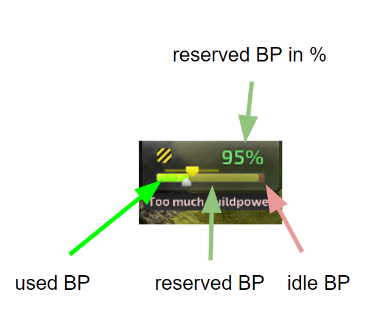
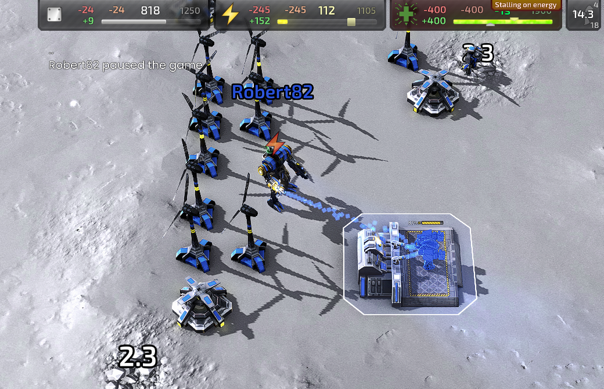

# Top Bar Widget for BAR

Enhance your gaming experience with the new Top Bar Widget for BAR (Beyond All Reason)! This widget offers a streamlined and informative interface, providing critical insights during gameplay.

## Features
- **Efficiency Indicator**: Easily monitor your build power resource utilization with a color-coded system.
- **Time Behind Calculation**: Instantly understand how efficiently you're using your build power (BP).

## Versions
The `gui_top_bar_alpha.lua` version is the one described here. It is stable :)

### Current variants (0.5.001): buildpower on top of the official top bar
Both files are the **current official BAR top bar** (an unmodified copy is kept in `reference/` for diffing) plus the buildpower bar. They replace the stock "Top Bar": disable "Top Bar" and enable exactly one of them. The buttons row is no longer part of the top bar in current BAR; keep the stock "Top Bar Buttons" widget enabled.

- `gui_top_bar_alpha_0.5.001_light.lua` ("Top Bar with Buildpower 0.5.001 light"): the official bar's own rendering (static parts rendered once into textures, value bars as display lists rebuilt only when their pixel width changes, texts only when the string changes) extended by a green buildpower bar between metal and energy: used BP fill, reserved BP overlay, percentage text, metal/energy supported-BP markers, wind range strip, stall flash, alerts and tooltips. Options (buildpower bar, eco indicators, wind range, debug tooltip) appear under the widget in the options menu. Safe choice.
- `gui_top_bar_alpha_0.5.001_gl4.lua` ("Top Bar with Buildpower 0.5.001 gl4"): same features, but every rectangle of the three bars (fills, glow, overlays, flash, slider knobs, markers) is one instance in a GPU instance buffer drawn by one shader, normally a single draw call per frame. Needs the GL4 engine features BAR itself uses; if they are missing or the shader fails to compile the widget prints the reason, recommends the light variant and removes itself.

### Performance ladder (0.5.002 to 0.5.004)
Each file builds on the previous one. All of them replace the stock "Top Bar"; enable exactly one. GL calls and allocation are mock-harness numbers for a steady frame with the sim running.

| File | Adds | GL calls / frame | Draw calls |
|---|---|---|---|
| `gui_top_bar_alpha_0.5.001_gl4.lua` | bars as GPU instances | 29 | 1 (+ display lists) |
| `gui_top_bar_alpha_0.5.002_gl4_lean.lua` | no Update callin (tick from GameFrame / IsAbove), no per-frame uniforms (engine timeInfo), one texture atlas, no draw-path allocation | 15 | 1 (+ display lists) |
| `gui_top_bar_alpha_0.5.002_gl4_lean_scan.lua` | lean + cheaper builder scan (GetUnitWorkerTask, no coroutine, no per-pass tables; roughly half the Lua time per frame at 1000 builders) | 15 | 1 (+ display lists) |
| `gui_top_bar_alpha_0.5.003_gl4_onedraw.lua` | lean + background/UI blits, wind blades and tidal wave folded into the single instanced draw | 11 | 1 |
| `gui_top_bar_alpha_0.5.004_gl4_glyphs.lua` | onedraw + all texts as glyph instances from a font atlas; no render-to-texture after init except on resize / language change | 13 | 1 |
| `gui_top_bar_alpha_0.5.005_gl4_tuned.lua` | glyphs + the cheaper builder scan + lower update rates: 10 Hz slow tick, 20 Hz only for fill widths (idle while paused), warning pulse and commander blink computed in the shader, rate texts only when the engine's 30-frame team slow update changed them, value text at most 10 Hz and rounded to steps of 5 between 100 and 999 unless hovered (`gl4.VALUE_STEP`) | 13 | 1 |

The builder-scan change (lean_scan) is independent of the draw-path steps and can be combined with onedraw/glyphs once the comparison shows which parts pay off.

Neither has been compared side by side in game yet. Use the "Widget Profiler" widget to compare their Draw/Update milliseconds against the stock "Top Bar".

### Top Bar Buttons (0.1.001 lean)
`gui_top_bar_buttons_alpha_0.1.001_lean.lua` ("Top Bar Buttons 0.1.001 lean") replaces the stock "Top Bar Buttons" widget (unmodified copy in `reference/`), same buttons, badge, auto-hide, quit/resign and save dialogs, keys and `WG.topbar` fallbacks. Changes: no Update callin (the stock one created three closures per frame for the top bar fallbacks), the strip is rendered once into a texture and drawn with one display list, hover highlight is one cached list per button instead of four immediate-mode rectangles per frame, the changelog pulse is time based, and the dialogs are rebuilt only when something they show changes instead of every frame. Mock numbers per frame, official vs lean: idle 3 vs 1 GL calls, hovering 164 vs 2, quit dialog open about 1055 vs 1, allocation 192 B vs 0 idle and 13 kB vs 0 with the quit dialog open.

### Benchmark (mock harness, same scenario for every file)
Lua microseconds per rendered frame at 60 fps with the sim at 30 Hz, median of 3 runs, 1920x1080. "Draw path" = DrawScreen + Update/IsAbove; "BP scan" = GameFrame (the stock top bar has no buildpower tracking, so its GameFrame is ~0.3 us). GL calls = Lua->GL calls per frame. Allocation is per frame with ~384 B of harness overhead already subtracted. Absolute numbers include mock overhead; the ratios are what matters.

| Top bar file | draw path running | draw path paused | BP scan, 10 builders | BP scan, 300 builders | GL calls | alloc B/frame |
|---|---|---|---|---|---|---|
| official `Top Bar` (reference/) | 31.5 | 16.7 | 0.3 (no BP) | 0.3 (no BP) | 44 | 880 |
| 0.5.001 light | 30.4 | 13.5 | 4.6 | 14.7 | 46 | 1030 |
| 0.5.001 gl4 | 24.7 | 16.3 | 3.9 | 13.5 | 30 | 830 |
| 0.5.002 gl4 lean | 16.8 | 10.1 | 6.8 | 16.1 | 16 | 475 |
| 0.5.002 gl4 lean+scan | 16.4 | 10.7 | 6.0 | 12.0 | 16 | 350 |
| 0.5.003 gl4 onedraw | 15.1 | 9.0 | 6.8 | 15.7 | 12 | 235 |
| 0.5.004 gl4 glyphs | 16.9 | 9.4 | 7.0 | 17.2 | 13 | 140 |
| 0.5.005 gl4 tuned | 11.7 | 7.9 | 6.9 | 12.6 | 13 | 10 |

| Top Bar Buttons file | idle | hover | changelog | paused | quit dialog open | GL calls idle / hover / dialog | alloc idle / hover / dialog |
|---|---|---|---|---|---|---|---|
| official `Top Bar Buttons` (reference/) | 2.2 | 70.1 | 16.1 | 2.0 | 431.8 | 3 / 164 / 1055 | 193 B / 2052 B / 13.6 kB |
| 0.1.001 lean | 0.8 | 1.4 | 1.4 | 0.8 | 1.5 | 1 / 2 / 1 | 0 / 0 / 0 |

Reproduce: scenario `scen_bench.lua` in the harness folders of this session (not part of the repo).

### Older variants
`old_versions/` keeps the 0.4.x line (based on a 2024 top bar) including the 0.4.011 light/gl4 experiments. They do not load on current BAR without fixes and are kept for reference only.

## Installation Guide

### Step 1: Download the Widget
First, download the `gui_top_bar_alpha.lua` file from our [GitHub repository](https://github.com/roberthartmann/widgets_for_BAR/blob/main/gui_top_bar_alpha.lua).

### Step 2: Place the Widget File
Place the downloaded file into your widgets folder. The path should be `your_bar_folder/data/luaui/widgets`.

### Step 3: Activate the Widget
Start a game, then press `F11` to access the widget menu. Filter for the top bar, deactivate the original top bar, and activate the new one.

### Step 4: Adjust Other Widgets
After activating the new top bar, reactivate any widgets that are positioned beside it. They may need to be readjusted to fit alongside the new top bar.

### Step 5: Understanding the Widget
To fully benefit from the widget, it's crucial to understand its functionalities. Refer to the images and descriptions in our repository to get a comprehensive overview.

Here is an image to help you better understand how to read it:

## Understanding the Sliders

### Metal Slider
The slider are a focal point where your eyes will often go.
It shows whether you need more build power or have too much.
- **Aim to keep the metal slider between 70% and 90% on the right.** This indicates that your metal income can supply almost all of your build power on current projects. Why aim for this range?
- **Avoid exceeding 90% on the metal slider.** If you have less build power (slider further to the right), you won’t spend all of your metal. Units leaving a factory and constructors moving toward blueprints can cause inefficiencies, so you need sufficient build power to spend all your metal.
- **Avoid dropping below 70% on the metal slider.** If you're below this threshold, you're wasting metal in unused BP. In the heat of battle, it’s common to rely on these indicators.

### Energy Slider
- **Aim to keep the energy slider at around double the metal slider or at 100%.**
- **Never run short on energy!** High-level players will often begin raids during low wind phases, when your LLTs won't shoot, so maintaining a healthy energy income is crucial.
- **Running out of energy is BAD!!!** Even if you're not raided, a lesser-known fact is that metal extractors will eventually stop producing metal if you run out of energy, which can be devastating.
- **Energy is vital for resurrecting units, which can easily be underestimated.** Rez bots are cheap and effective but can drain your economy. The energy slider will show you this. Be mindful of your energy needs!

### A Quick Example
(older version) In this example, you can see that you're depleting your energy storage at an unhealthy rate. You will soon stall on energy, which might cause your metal extractors to produce less metal. Eventually, your metal storage will also be empty, which is generally undesirable. The solution? Use your commander to build wind or solar energy structures. This will reduce your energy consumption and increase your energy income—a win-win situation! 

## Feedback and Contributions
Your feedback and contributions are welcome! Feel free to raise issues or submit pull requests on our [GitHub repository](https://github.com/roberthartmann/widgets_for_BAR).
